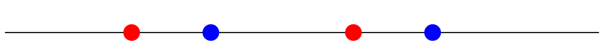

# Research

---

## Eigenvalue configurations {#eigenvalue-configurations}
This is the topic of [my PhD dissertation](./resources/dis.pdf).

Real symmetric matrices can be found in nearly any area of
mathematics, science, and engineering: covariance matrices in
statistics, Hessians in statistics and optimization, Laplacian
matrices in graph theory, and stress tensors in mechanics, to name a
few. Often, we are interested in their (real) eigenvalues and their
arrangements on the real line.

Let $$F \in \mathbb{R}^{m \times m}$$ and $$G \in \mathbb{R}^{n \times
n}$$ be real symmetric matrices with eigenvalues $$\alpha_1 \le \dots
\le \alpha_m$$ and $$\beta_1 \le \dots \le \beta_n$$,
respectively. Their eigenvalue configuration, written $$\mathrm{EC}(F,
G)$$, is the relative arrangement of the $$\alpha$$'s and the
$$\beta$$'s on the real line. When $$F$$ and $$G$$ do not share
eigenvalues (we call this a *generic pair*), the eigenvalue
configuration is

$$\mathrm{EC}(F, G) = (c_1, \dots, c_m),$$

where $$c_i$$ is the number of eigenvalues of $$G$$ lying between
$$\alpha_i$$ and $$\alpha_{i+1}$$, and $$c_m$$ is the number of
eigenvalues of $$G$$ larger than $$\alpha_m$$. (The number of
eigenvalues of $$G$$ below $$\alpha_1$$ is therefore $$n - c_1 - \dots - c_m$$.)

**Example.** Let

$$F = \begin{bmatrix} 1 & 1 \\ 1 & 3 \end{bmatrix}, \qquad G = \begin{bmatrix} 2 & -1 \\ -1 & 4 \end{bmatrix}.$$

The eigenvalues of $$F$$ are $$2 \pm \sqrt{2} \approx 0.59, 3.41$$ and
the eigenvalues of $$G$$ are $$3 \pm \sqrt{2} \approx 1.59, 4.41$$, so
$$\alpha_1 < \beta_1 < \alpha_2 < \beta_2$$. Pictorially, the
eigenvalues are arranged as follows ($$\alpha$$'s are red and
$$\beta$$'s are blue):

There is one eigenvalue of $$G$$ in $$(\alpha_1, \alpha_2)$$ and one
in eigenvalue of $$G$$ greater than $$\alpha_2$$.
Hence, we have $$\mathrm{EC}(F, G) = (1, 1)$$.

### The problem
Suppose now that the entries of $$F$$ and $$G$$ are not simply numbers
but instead depend on some parameters $$p = (p_1, \dots, p_t)$$. 
For matrices larger than $$4 \times 4$$, we can no longer compute the
eigenvalues symbolically. 
We have the following problem:

- **In**: parametric real symmetric matrices $$F$$ and $$G$$, and a
  desired eigenvalue configuration $$c$$
- **Out**: a "simple" condition on the parameters $$p$$ such that $$\mathrm{EC}(F, G) = c.$$

Writing down *some* condition on $$p$$ is easy. We can write down

$$\exists\, \alpha_1, \dots, \alpha_m,\ \beta_1, \dots, \beta_n \ \
\Phi_c(\alpha_1, \dots, \alpha_m, \beta_1, \dots, \beta_n, p),$$

where $$\Phi_c$$ says "the $$\alpha$$'s and $$\beta$$'s are the
eigenvalues of $$F$$ and $$G$$ and are arranged according to $$c$$".
But this expression involves the eigenvalues, which cannot in general
be symbolically represented in terms of $$p$$, and involves
quantification over an infinite set (namely, the real numbers), which
cannot be evaluated by a computer. 
Thus, by "simple," we mean *quantifier-free*: an expression involving
semialgebraic conditions on the parameters $$p$$ only.

In a landmark result, the logician Alfred Tarski proved that the
general problem of rewriting a logical expression without quantifiers,
called *quantifier elimination*, is always possible over real closed
fields. In fact, he even gave an algorithm for doing so, and many
improved algorithms have been developed since. However, these general
algorithms, while very powerful, are time-consuming to run and produce
very large unstructured output expressions. Hence, they are
intractable for most applications. The challenge, therefore, is to
find an efficient algorithm that exploits the structure of this
particular problem and produces structured output.

### Motivation: Descartes' rule of signs

Descartes' rule of signs says that the number of positive roots of a
real polynomial is at most the number of sign changes in its
coefficients, with equality when all the roots are real.
Take $$F = [0]$$ and

$$G = \begin{bmatrix} 1 & 2 \\ 2 & 1 \end{bmatrix}, \qquad g(x) =
\det(xI - G) = x^2 - 2x - 3 = (x + 1)(x - 3).$$

The coefficients of $$g$$, in order, have signs $$(+, -, -)$$, and there is
exactly one sign change. By Descartes' rule of signs, $$G$$ therefore has exactly one positive
eigenvalue, so $$\mathrm{EC}(F,G) = (1)$$. This example shows that the
eigenvalue configuration problem generalizes Descartes' rule of signs
by allowing arbitrary matrices for $$F$$ instead of just the zero matrix.

Descartes' rule of signs is itself used widely in many areas of
science and engineering, so we can expect that a more general result
will have even wider applicability. For example:

- **Rank updates**. If $$G = F + UCU^T$$ is a rank-$$r$$ update of
  $$F$$, how do the eigenvalues of $$F$$ move? For $$r = 1$$ the
  classical result is that the eigenvalues interlace, but for larger
  $$r$$ much less is known.
- **Network analysis.** If $$F$$ is the adjacency matrix (or
  Laplacian) of a graph, adding or removing edges corresponds to
  low-rank updates of this matrix, and many graph properties are
  determined from the eigenvalues.
- **Constrained optimization**. Optimizing an objective function over
  the parameters of a system subject to a constraint like "the
  eigenvalues of $$F$$ and $$G$$ are arranged corresponding to $$c$$"
  (for instance, a stability condition) requires that the constraint
  be expressable without quantifiers in terms of the parameters.

### First approach: signature of matrices

The *signature* $$\sigma(M)$$ of a real symmetric matrix $$M$$ is the number of
positive eigenvalues of $$M$$ minus the number of negative eigenvalues
of $$M$$.

Let $$f = \det(xI - F)$$ be the characteristic polynomial of $$F$$. 
For $$e = (e_0, \dots, e_{m-1}) \in \{0,1\}^m$$ define

$$f_e = \left(f^{(0)}\right)^{e_0} \cdots
\left(f^{(m-1)}\right)^{e_{m-1}},$$

where $$f^{(k)}$$ is the $$k$$-th derivative of $$f$$. Each $$f_e(G)$$ is a
symmetric matrix whose entries are polynomials in the entries of
$$F$$ and $$G$$. Our first theorem says that for a generic pair of
matrices $$F$$ and $$G$$, we have

$$\mathrm{EC}(F, G) = C_{\mathrm{sig}}\, A_{\mathrm{sig}}(F, G),$$

where

- $$C_{\mathrm{sig}}$$ is a rational matrix depending only on $$m$$
  (see [Definition 26 here](./resources/dis.pdf#page=27) for details), and
- $$A_{\mathrm{sig}}(F, G)$$ is the vector of signatures
$$\sigma(f_e(G))$$.

**Example ($$m = 2$$).** Here $$f_{00} = 1$$, $$f_{01} = f'$$, $$f_{10} = f$$
and $$f_{11} = f f'$$, and

$$\begin{bmatrix} c_1 \\ c_2 \end{bmatrix} = \begin{bmatrix} \frac{1}{2} & 0 & -\frac{1}{2} & 0 \\ \frac{1}{4} & \frac{1}{4} & \frac{1}{4} & \frac{1}{4} \end{bmatrix} \begin{bmatrix} \sigma(I) \\ \sigma(f'(G)) \\ \sigma(f(G)) \\ \sigma(f(G)f'(G)) \end{bmatrix}.$$

To see why, note that the eigenvalues of $$f(G)$$ are simply
$$f(\beta_j)$$, and $$f(\beta_j) < 0$$ exactly when $$\alpha_1 <
\beta_j < \alpha_2$$. 
In terms of the signature of $$f(G)$$, we therefore have

$$ c_1 = \#\{\beta_j \in (\alpha_1, \alpha_2)\} = \frac12 (n - \sigma(f(G))) = \frac12 (\sigma(I) - \sigma(f(G))),$$

which corresponds to the first row in the above matrix multiplication.

Similarly, we have $$\beta_j > \alpha_2$$ if and only if both
$$f(\beta_j) > 0$$ and $$f'(\beta_j) > 0$$. Therefore

$$ c_2 = \# \{\beta_j \in (\alpha_2, \infty)\} = \frac14 (n +
\sigma(f'(G)) + \sigma(f(G)) + \sigma(f(G) f'(G))),$$

which corresponds to the second row in the above matrix multiplication.

Given the example matrices $$F = \begin{bmatrix} 1 & 1 \\ 1 & 3
\end{bmatrix}, \qquad G = \begin{bmatrix} 2 & -1 \\ -1 & 4
\end{bmatrix},$$ we have $$f(x) = x^2 - 4x + 2$$, and one can compute
that $$\sigma(f'(G)) = 0$$, $$\sigma(f(G)) = 0$$ and
$$\sigma(f(G)f'(G)) = 2$$, so $$c_1 = \frac{1}{2}(2 - 0) = 1$$ and
$$c_2 = \frac{1}{4}(2 + 0 + 0 + 2) = 1$$, as expected.

The condition (which is the matrix multiplication above) is
quantifier-free because the signature of a real symmetric matrix can
be computed directly using Descartes' rule of signs on the
coefficients of the characteristic polynomials of $$f_e(G)$$. These
coefficients are themselves polynomials in the parameters, so the
final condition involves only the parameters and not the eigenvalues.
This approach is implemented in the Maple script [`ECSignature`](https://danielprofili.github.io/software#signature).

### Second approach: symmetric polynomials

Our second approach solves the same problem, but uses an entirely
different method. For each $$r = 1, \dots, m$$, consider the
polynomial

$$h_r = \prod_{\substack{I \subseteq \{1, \dots, m\},\ \#I = r \\ j
\in \{1, \dots, n\}}} \left( x + \prod_{i \in I} (\alpha_i - \beta_j)
\right).$$

Its roots are all real, and the number of its positive roots counts
the pairs $$(I, j)$$ for which $$\prod_{i \in I}(\alpha_i - \beta_j) < 0$$,
which carries information about where $$\beta_j$$ sits relative to the
$$\alpha$$'s (see [Lemma 74 here](./resources/dis.pdf#page=73) for details).
Further, the coefficients of $$h_r$$ are themselves symmetric
polynomials in $$\alpha$$ and $$\beta$$, so by the fundamental theorem
of symmetric polynomials they cna be rewritten as polynomials $$D_r$$
in the coefficients of the characteristic polynomials of $$F$$ and
$$G$$.

Our second theorem has the same shape as the previous theorem and says
that

$$\mathrm{EC}(F, G) = C_{\mathrm{sym}}\, A_{\mathrm{sym}}(F, G),$$

where
- $$C_{\mathrm{sym}}$$ is an $$m \times m$$ rational matrix that again
depends only on $$m$$, and
- $$A_{\mathrm{sym}}$$ is the vector of sign variation counts of the
$$D_r$$ (the numbers of positive roots, by Descartes' rule of signs).

See [Example 69 here](./resources/dis.pdf#page=68) for a fully worked example.

This approach is implemented in
[`ECSymmetry`](https://danielprofili.github.io/software#symmetry).

In both approaches, the output has size $$n(2^m - 1)$$ (counting the
total number of polynomials in the parameters). Note that if $$m$$ is
fixed, the output grows only linearly in $$n$$; thus, in practice, one
should choose $$F$$ to be the smaller matrix. Setting $$m=1$$ gives an
output of size $$n$$, which is exactly Descartes' rule of signs.

### Shared eigenvalues

The above definition for $$\mathrm{EC}$$ breaks down when $$F$$ and
$$G$$ share an eigenvalue, since any shared eigenvalue will not lie in
any of the open intervals between $$\alpha$$'s. The key observation is
that if we have matrices $$F$$ and $$G$$ which share an eigenvalue (in
the terminology established, the pair is *not generic*), a
sufficiently small perturbation can produce a new pair of matrices
which is generic. So a natural definition we can make is to let the
eigenvalue configuration of non-generic pairs be the *average* over
all such small perturbations:

$$\mathrm{EC}(F, G) = \frac{1}{2^m} \sum_{d \in \{-1, 1\}^m}
\mathrm{GEC}(F_d, G),$$

where 
- $$F_d$$ is a matrix with eigenvalues $$\alpha_i + \varepsilon d_i$$ for
  sufficiently small $$\varepsilon$$ and $$d_i \in \{-1, 1\}$$
- $$\mathrm{GEC}$$ denotes the eigenvalue configuration
  defined in the previous section. We rename it "$$\mathrm{GEC}$$" to
  emphasize that $$F_d$$ and $$G$$ are *always* generic (for a
  suitable $$\varepsilon$$).

Note that if $$F$$ and $$G$$ are a generic pair, this new definition
reduces to the old one, so it is truly a generalization.

**Example.**[^1] Try it below:



With this new definition, both theorems from the previous sections
hold for arbitrary real symmetric matrices with only minor modifications (see
[here](./resources/dis.pdf#page=91) and
[here](./resources/dis.pdf#page=102) for details).

---

## Resultant polytopes {#resultant-polytopes}

Suppose we have polynomials $$f_1, \dots, f_n \in \mathbb{C}[x_1,
\dots, x_m],$$ each of the form

$$f_i = b_{i, 1} x_1^{a_{i,1}} + \dots + b_{i, m} x_m^{a_{i, m}},$$

where $$b_{i,k} \in \mathbb{C}$$ and $$a_{i, k} \in \mathbb{Z}.$$ What
can we say about the choices of coefficients $$b_{i,k}$$ which satisfy
$$f_1 = \dots = f_n = 0$$?

There is a unique (up to scaling) polynomial called the *resultant*
which is defined as a polynomial $$R$$ in
the coefficients such that $$R(b_{1,1}, \dots, b_{n, m}) = 0$$ if and
only if the $$b_{i, j}$$'s satisfy $$f_1 = \dots = f_n = 0$$. 

The resultant is readily computed by calculating the elimination ideal
(e.g. by Groebner basis) the ideal $$I = (f_1, \dots, f_n)$$ generated
by the polynomials. The generator of the elimination ideal is
precisely the resultant; however, in general, this operation is very
slow as computing Groebner bases is computationally intensive (in both a theoretical sense and a practical sense: Buchberger's algorithm, [the primary method for computing Groebner bases](https://en.wikipedia.org/wiki/Faug%C3%A8re%27s_F4_and_F5_algorithms), runs in about double-exponential time and computing resultants in quantities in the thousands in Sage without parallelism takes a modest computer anywhere from hours to days).

Below is a simple example resultant computed using
[SageMath](https://www.sagemath.org). Here, we define

$$p_1 = a_{11}x_1 + a_{12}x_2 + a_{13}$$

$$p_2 = a_{21}x_1 + a_{22}x_2 + a_{23}$$

$$p_1 = a_{31}x_1 + a_{32}x_2 + a_{33}$$

which live in the ring $$\mathbb{Q}[x_1, x_2]$$, and compute the generator of
the corresponding elimination ideal of $$I$$ with respect to $$x_1$$ and $$x_2$$.

The last line, `resultant.newton_polytope()`, computes the *Newton
polytope* of the resultant, which is defined as the convex hull of the
exponent vectors of the resultant polynomial. (By exponent vectors, we
mean the ordered tuples of integers whose $$i$$th entry is the exponent of
$$x_i$$ in any particular monomial.)

The Newton polytope is useful not only because it is a way to
visualize a polynomial, but it also provides a link to the powerful
tools of algebraic and tropical geometry. As it turns out, there is a
bijection between the number of vertices of the Newton polytope of the
resultant and the number of arrangements of *tropical
hypersurfaces* corresponding to the original polynomials. 

### Tropical geometry

Tropical geometry is the study of the tropical semiring, which is
usually defined as $$\mathcal{T} = (\mathbb{R} \cup \{+\infty\},
\oplus, \otimes)$$ where the ring operations are defined by

$$x \oplus y = \min(x, y)$$

$$x \otimes y = x + y.$$

Equivalently, we can substitute $$-\infty$$ and define $$x \oplus y =
\max(x, y).$$ Under this interpretation, the tropical semiring can be
thought of as a projection of the real numbers under the logarithm map, 
using the fact that for $$x$$ and $$y$$ sufficiently far apart we have

$$\log(x + y) \approx \log \max(x, y) \text{ and}$$

$$\log(xy) = \log x + \log y.$$ 

An important fact to note is that these definitions satisfy all but
one of the ring axioms; i.e. the set $$\mathbb{R} \cup \infty$$ is an
abelian group under $$\oplus$$, the $$\otimes$$ operation
distributes and is associative, and $$\infty$$ acts as the additive
identity or "zero." The only missing axiom is the presence of additive
inverses; for instance, there is no element $$y$$ such that $$\min(5, y) = \infty$$.

The tropical semiring induces a mechanism by which we can
"linearlize" polynomials. For example, the tropical projection of

$$p(x, y) = x^2 + y^5 + 2xy + 10$$

is

$$\mathcal{T}(p(x)) = (x^{\otimes 2}) \oplus (y^{\otimes 5})
\oplus (2 \otimes x \otimes y) \oplus 10 =
\min(2x, 5y, 2+x+y, 10).$$

As we can see, plotting the tropical curve results in a
concave, piecewise linear function (note that if we use the maximum instead of
the minimum, we get a convex function instead). The points where the
piecewise components join together are called *roots*; equivalently,
these are the points at which the minimum of the tropical polynomial
is achieved more than once. The number of times the minimum value is
achieved is called the *order* of the root, and this is equal to the
difference in neighboring slopes at each root point.

The last line prints the Newton polytope of the original
polynomial. If you look closely, you'll see that the slopes of the
edges of the polytope are inverses of the slopes of the tropical
curve---put precisely, the tropical curve can be identified with the
*normal fan* of the polytope. Here is where the connection between
tropical geometry and resultants shines through: it is much easier to
deal with minima and sums than it is to deal with multiplication,
addition, and exponentiation, so if we can think about tropical
curves, we might be able to speed up resultant computations and avoid
Groebner basis calculations altogether.

[^1]: The demo tool was made by an LLM.
